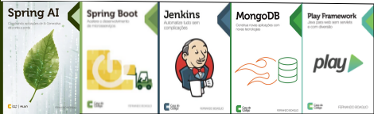

# 👋 Fernando Boaglio

Paulistano, nerd :computer: and Java developer. Author of **4 published books**, JUG leader of [Java Meetup SP](https://linktr.ee/javameetupsp), and YouTuber — hacking, coffee, and *don't give up, skeleton!* :grin:

### 🛠️ Tech

---

## 📚 My Books

Please browse my repositories and buy my books!

| Book | Repos |
|------|-------|
| :blue_book: [Spring Boot: Acelere o desenvolvimento de microsserviços](https://www.casadocodigo.com.br/products/livro-spring-boot) | [browse Spring repos](https://github.com/boaglio?tab=repositories&q=spring) |
| :closed_book: [Jenkins: Automatize tudo sem complicações](https://www.casadocodigo.com.br/products/livro-jenkins) | [browse Jenkins repos](https://github.com/boaglio?tab=repositories&q=jenkins) |
| :green_book: [MongoDB: Construa novas aplicações com novas tecnologias](https://www.casadocodigo.com.br/products/livro-mongodb) | [browse MongoDB repos](https://github.com/boaglio?tab=repositories&q=mongo) |
| :orange_book: [Play Framework: Java para web sem Servlets e com diversão](https://www.casadocodigo.com.br/products/livro-play-framework-java) | [browse Play repos](https://github.com/boaglio?tab=repositories&q=play) |

:coffee: [browse all my Java repos](https://github.com/boaglio?tab=repositories&q=java)

---

## 🎥 YouTube & Community

- :microphone: [Canal do YouTube DevMultitask](https://youtube.com/DevMultitask)
- :coffee: [Java Ring](https://youtube.com/@JavaRing)
- :coffee: [JUG leader — Java Meetup SP](https://linktr.ee/javameetupsp)
- :palm_tree: [Link Tree](https://linktr.ee/boaglio)

---

## 📊 GitHub Stats

